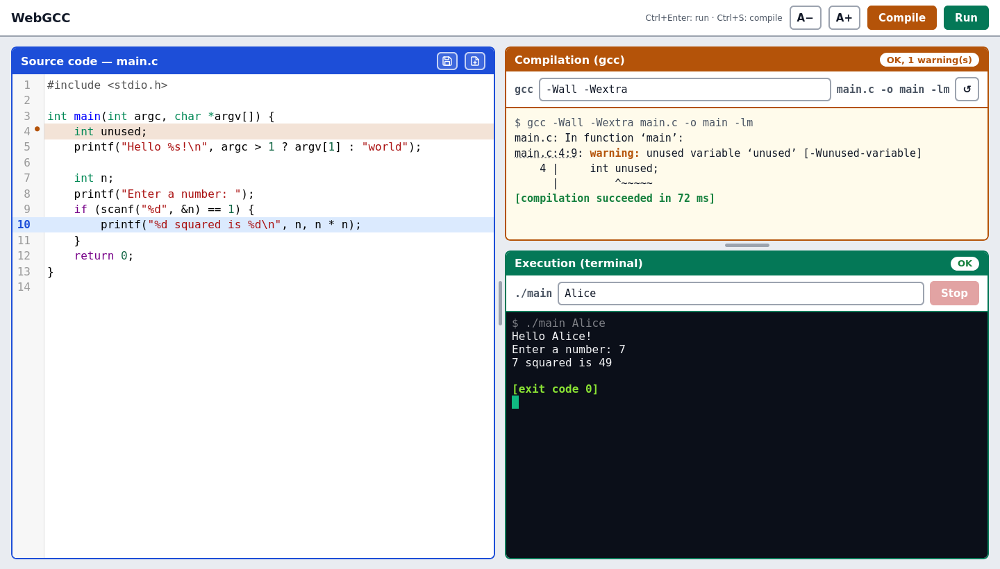

# webgcc

> TL;DR: a micro IDE in a web page to help students learn C: edit a program, compile it with `gcc` and run it in a
> live terminal, on a page made to be projected on the classroom screen.



**webgcc** is a teaching tool. It was written to teach C to first year engineering students: during the lesson, the
teacher writes code on the projected page, shows what `gcc` says about it, then runs the program in front of everyone.
No editor setup, no terminal juggling, the whole edit / compile / run loop fits on one screen with large fonts.

Under the hood it is a small FastAPI application: the browser sends the source code, the server compiles it with the
real `gcc` and runs the binary in a pseudo-terminal, streamed to the page over a websocket. What students see is
exactly what they would get in their own terminal, including `scanf` prompts, `Ctrl+C` and segmentation faults.

# Quick start

The page is then available on http://127.0.0.1:8000.

## With Docker / Podman

```sh
$ docker run --rm -p 127.0.0.1:8000:8000 --pids-limit 256 --memory 1g ghcr.io/essembeh/webgcc
```

The image embeds `gcc`, the C library headers and `clang-format`, nothing else is needed.

## With uvx, from the sources

Requirements: Linux (pty), `gcc` and [uv](https://docs.astral.sh/uv/), optionally `clang-format` for the format button.

```sh
$ uvx --from git+https://github.com/essembeh/webgcc webgcc
```

## From a clone

Same requirements, for development or to change the code:

```sh
$ git clone https://github.com/essembeh/webgcc
$ cd webgcc
$ uv run webgcc
```

# Features

- **Editor** (CodeMirror): C syntax highlighting, line numbers, highlighted current line, bracket matching,
  download the source as `main.c`, new empty document, code formatting with `clang-format` (`Ctrl+Z` brings the
  previous code back)
- **Compilation**: editable `gcc` options (e.g. remove `-Wall -Wextra` to show what they bring), raw `gcc` output with
  clickable `main.c:LINE:COL` locations, errors and warnings marked in the editor gutter
- **Execution** in a live terminal (xterm.js + pty):
  - optional command line arguments, with shell-like quoting (`42 "two words"`)
  - interactive standard input, output streamed as it is produced
  - `Ctrl+C` sends `SIGINT`, `Ctrl+D` sends EOF, the **Stop** button kills the program
  - exit status explained: return code, or signal (`SIGSEGV`, `SIGFPE`…)
- **Made for projection**: one strong color per panel, `A-`/`A+` buttons to scale all the code fonts,
  draggable splitters between the panels
- **Keyboard shortcuts**: `Ctrl+Enter` runs (compiling first when needed), `Ctrl+S` compiles only
- **Works offline**: all front-end libraries are served by the application, no CDN

# Security

> [!WARNING]
> webgcc compiles and runs **arbitrary C code** sent by the browser. The only protections are resource limits
> (CPU time, memory, file size), a wall-clock timeout and killing the whole process group at the end of each run.
>
> By default it listens on `127.0.0.1` only. Do not expose it to other users without a real isolation layer:
> at least the container image, ideally with a dedicated network and no access to anything sensitive.

# Configuration

Settings are read from environment variables prefixed with `WEBGCC_`:

| Variable | Default | Description |
| --- | --- | --- |
| `WEBGCC_HOST` | `127.0.0.1` | Listening address (`0.0.0.0` in the container image) |
| `WEBGCC_PORT` | `8000` | Listening port |
| `WEBGCC_GCC` | `gcc` | Compiler executable |
| `WEBGCC_CFLAGS` | `["-Wall","-Wextra"]` | Default compiler options, editable in the page |
| `WEBGCC_LDFLAGS` | `["-lm"]` | Options placed after the source file |
| `WEBGCC_GCC_LOCALE` | `C.UTF-8` | Locale of `gcc`, English diagnostics are needed to link them to the editor |
| `WEBGCC_CLANG_FORMAT` | `clang-format` | Formatter executable, the format button is disabled if it is missing |
| `WEBGCC_FORMAT_STYLE` | `{BasedOnStyle: LLVM, IndentWidth: 4, ColumnLimit: 100}` | `clang-format --style` value |
| `WEBGCC_COMPILE_TIMEOUT` | `15` | Compilation (and formatting) timeout, in seconds |
| `WEBGCC_RUN_TIMEOUT` | `300` | Wall-clock limit of a run, in seconds |
| `WEBGCC_CPU_LIMIT` | `30` | CPU time limit of a run, in seconds |
| `WEBGCC_MAX_MEMORY_MB` | `512` | Address space limit of a run |
| `WEBGCC_MAX_FILE_MB` | `10` | Maximum size of a file written by a run |
| `WEBGCC_MAX_OUTPUT_RATE` | `512000` | Terminal output throttling, in bytes per second |
| `WEBGCC_MAX_OUTPUT_BYTES` | `64000` | Maximum size of the `gcc` output |
| `WEBGCC_MAX_SOURCE_BYTES` | `200000` | Maximum size of the source code |
| `WEBGCC_MAX_BUILDS` | `50` | Number of compiled binaries kept on disk |

# Development

The `Justfile` is the entry point:

```sh
$ just run            # start the app on http://127.0.0.1:8000
$ just dev            # same, with auto-reload
$ just check          # ruff format + ruff check + mypy (CI job "check")
$ just test           # pytest with coverage, needs gcc (CI job "test")
$ just vendor         # download the front-end libraries into src/webgcc/static/vendor
$ just docker-build   # build the container image with podman
$ just docker-run
```

Releases: `just release [patch|minor|major]` bumps the version, commits and tags, then `just publish` pushes.
The CI publishes the image on `ghcr.io` for each tag (and `edge` for `main`).

# License

Apache-2.0. The embedded front-end libraries keep their own licenses:
[CodeMirror 5](https://codemirror.net/5/) and [xterm.js](https://xtermjs.org/), both MIT
(see `src/webgcc/static/vendor/LICENSE-*`).
